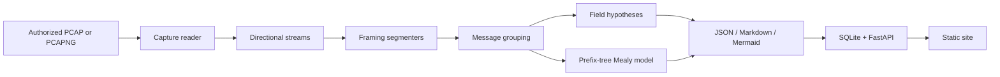

<p align="center">
  
</p>

<h1 align="center">ProtoMind</h1>

<p align="center">
  <a href="https://github.com/nihalmachhi/ProtoMind/actions/workflows/ci.yml"></a>
  <a href="LICENSE"></a>
  
  
</p>

**A local-first workbench that turns an authorized packet capture into an inspectable protocol hypothesis.**

Live site: https://nihalmachhi.github.io/ProtoMind/

ProtoMind reassembles TCP and UDP streams, infers message framing, groups observed
message types, proposes field boundaries, learns a prefix-tree Mealy model, and
exports JSON, Markdown and Mermaid artifacts. Every boundary is labelled as a
hypothesis with confidence and evidence. Active probes are off by default and
restricted to literal loopback targets.

> **Synthetic data.** The evaluation report is generated from hand-written captures.
> It verifies the pipeline; it is not evidence of real-world protocol accuracy.

---

## Why this exists

- **Protocol work starts with structure.** Before you can test a parser, you need to
  know where messages begin and end, which fields repeat, and which replies follow
  which requests.
- **Most tools are opaque.** ProtoMind keeps framing scores, message groups, field
  confidence and state transitions visible instead of hiding them behind a single
  answer.
- **Active probing is risky.** The passive pipeline needs no network access. The one
  active endpoint is loopback-only, rate-limited and timed out.
- **Claims should be reproducible.** The evaluation, site fixtures and docs are
  generated from the same Python code and checked in CI.

## What it does

| Area | Implementation |
|---|---|
| **Capture input** | Offline PCAP/PCAPNG parsing with a size limit and extension check. |
| **Reassembly** | Directional TCP streams with sequence ordering, duplicate and overlap handling; UDP datagrams preserved. |
| **Framing** | CRLF/LF/NUL delimiters, 1/2/4-byte length prefixes in both endiannesses, fixed-size records and an opaque fallback. |
| **Message grouping** | Direction plus first-token labels with observed examples. |
| **Field hypotheses** | Constant columns, the first varying region, printable-string detection and confidence. |
| **State model** | Prefix-tree Mealy hypothesis from observed request/reply pairs. |
| **Artifacts** | JSON IR, Markdown spec and Mermaid state diagram. |
| **Run store** | SQLite metadata with capture SHA-256 and result JSON; connections close after each operation. |
| **Guarded probes** | Literal loopback IPs only, no DNS, 2s timeout, 30 requests/minute. |
| **Redaction** | AUTH, LOGIN and PASS arguments are masked before examples and experiment rows are stored. |
| **Evaluation** | Deterministic synthetic captures with framing, message, session and transition checks. |

## How it works



Read [docs/architecture.md](docs/architecture.md) for the stage details and
[docs/threat-model.md](docs/threat-model.md) for the adversarial assumptions.

## Quick start

**Requirements:** Python 3.11+, [uv](https://docs.astral.sh/uv/), Node.js 22 for the
site, and Docker Compose v2 if you want the contained API container.

```bash
uv sync --extra dev
uv run python scripts/tools/generate_tinykv_capture.py
uv run uvicorn protomind.api.main:app --reload
```

Open <http://127.0.0.1:8000/docs>, upload
`data/captures/tinykv-demo.pcap`, then inspect the run, message types, fields and
state machine. The demo capture contains demo-only credentials (`demo` / `demo`).

Run the site separately:

```bash
cd site
npm ci
npm run dev
```

Or run the API in the contained Compose service:

```bash
docker compose up --build
```

The Compose service publishes `127.0.0.1:8000` only.

## API

| Method | Endpoint | Purpose |
|---|---|---|
| `GET` | `/health` | Liveness. |
| `POST` | `/captures` | Upload a capture and run the pipeline. |
| `GET` | `/runs/{run_id}` | Run status and result. |
| `GET` | `/runs/{run_id}/artifacts/{json,markdown,mermaid}` | Download artifacts. |
| `POST` | `/experiments/query` | Guarded loopback probe. |

See [docs/api.md](docs/api.md) for limits, status codes and settings.

## Verify it

```bash
uv run ruff check .
uv run ruff format --check .
uv run mypy src
uv run pytest -q --cov=protomind --cov-report=term-missing
uv run python -m protomind.evaluation
uv run python site/scripts/export_fixtures.py

cd site
npm ci
npm run lint
npm run typecheck
npm test -- --run
npm run build
```

The Python suite enforces 80% branch coverage. The generated report lives at
[docs/evaluation.md](docs/evaluation.md) and is labelled synthetic. The site
simulator is tested against fixtures generated from the Python segmenters.

## Project layout

```
src/protomind/
  capture/       PCAP parsing and directional stream assembly
  segmentation/  delimiter, length-prefix and fixed-size candidates
  clustering/    observed message grouping
  fields/        constant-column and varying-region hypotheses
  statemachine/  prefix-tree Mealy model
  spec/          JSON, Markdown and Mermaid export
  safety/        loopback target guard and credential redaction
  storage/       SQLite run and experiment store
  api/           FastAPI app and settings
  pipeline.py    stage orchestration
  evaluation.py  deterministic synthetic evaluation
docs/            architecture, threat model, privacy, API, testing, limitations
site/            React 19 + Vite showcase and framing lab
scripts/tools/   synthetic TinyKV capture generator
targets/tinykv/  toy loopback protocol for demos
tests/           unit and integration tests
```

## Safety

- Use only captures and systems you own or are authorized to inspect.
- Passive analysis is offline. Active probes are disabled unless you call the guarded
  endpoint.
- The guard accepts literal loopback IPs by default; DNS names and external addresses
  are refused.
- Raw captures are retained locally and are not redacted. Do not upload secrets.
- The API has no authentication or TLS. Keep it on loopback.
- There is no scanning, exploit generation, TLS decryption or malware analysis.

## Scope and limitations

This is a local learning build, not a production protocol reverse-engineering suite.
Framing, field labels and state transitions are hypotheses. The evaluation uses five
hand-written captures, so a 100% pass rate means the implementation matches its
fixtures, not that it understands arbitrary protocols. Read
[docs/limitations.md](docs/limitations.md) before drawing conclusions from the output.

## Documentation

- [Architecture](docs/architecture.md)
- [Threat model](docs/threat-model.md)
- [Privacy](docs/privacy.md)
- [API](docs/api.md)
- [Testing](docs/testing.md)
- [Synthetic evaluation](docs/evaluation.md)
- [Limitations](docs/limitations.md)
- [Final QA](docs/qa.md)

## Author

**Nihal Machhi** · [GitHub](https://github.com/nihalmachhi)

## License

MIT. See [LICENSE](LICENSE).
