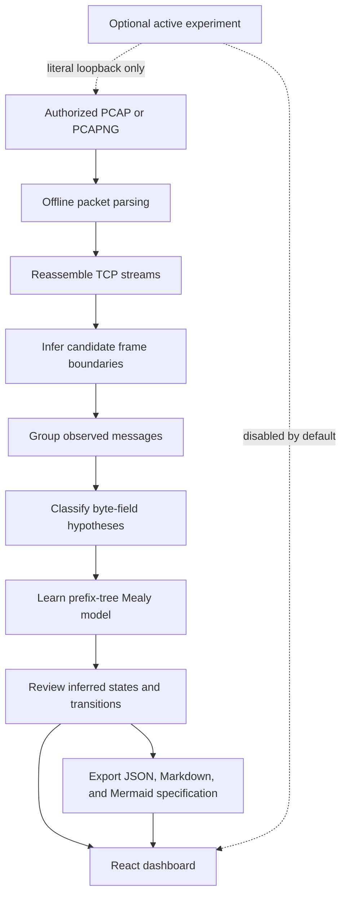

<p align="center">
  
</p>

<h1 align="center">ProtoMind</h1>

ProtoMind is a local-first protocol discovery workbench. Import an authorized PCAP/PCAPNG capture, reassemble TCP streams, infer candidate framing, group observed message types, classify byte fields, learn a prefix-tree Mealy model, and export JSON, Markdown, and Mermaid artifacts.

The first build focuses on a transparent, reproducible baseline for plaintext lab protocols such as TinyKV. Statistical inference is kept separate from any optional language-model naming; no language model makes structural decisions. Active probes are only allowed to literal loopback IP addresses in this build. Hostnames and external/private-network targets are refused.

## How it works

ProtoMind passively turns an authorized capture into candidate protocol structure. Each inferred boundary, field label, and state transition is a hypothesis that should be checked against the trace.



Statistical inference makes structural decisions; optional language-model naming is kept separate. Active experiments are disabled by default and restricted to literal loopback targets. Encrypted or compressed payloads cannot be inferred by this build.

## Run locally

Requires Python 3.11+ and Node.js 20+.

```powershell
uv sync --extra dev
uv run uvicorn protomind.api.main:app --reload
```

Or run the API and React dashboard together with Docker Desktop:

```powershell
docker compose up --build
```

For a local frontend development server, use a second terminal:

```powershell
cd dashboard
npm install
npm run dev
```

Generate a safe synthetic TinyKV capture and analyze it with the API or dashboard:

```powershell
uv run python tools/generate_tinykv_capture.py
```

Then upload `data/captures/tinykv-demo.pcap` in the dashboard. The generated trace contains demo-only credentials (`demo` / `demo`).

Open http://localhost:5173. API docs: http://localhost:8000/docs. Upload an authorized PCAP from the dashboard, then inspect sessions, inferred types, fields, machine, and generated spec.

## Test

```powershell
uv run pytest
uv run ruff check .
cd dashboard
npm run build
```

## Architecture

- `protomind/capture`: offline packet parsing and directional TCP stream assembly.
- `protomind/segmentation`: delimiter, length-prefix, and fixed-size candidates plus scoring.
- `protomind/clustering` and `fields`: observed type grouping and conservative field classification.
- `protomind/statemachine`: passive prefix-tree Mealy model from request/reply traces.
- `protomind/spec`: JSON IR, Mermaid diagram, and Markdown export.
- `protomind/safety`: allowlist and bounded-rate checks for optional lab interactions.
- `protomind/storage` and `api`: run metadata, capture upload, pipeline and artifact routes.
- `targets/tinykv`: a toy protocol implementation for a controlled local demo. Start it with `uv run python targets/tinykv/server.py`; it binds to loopback only.
- `dashboard`: React and React Router interface.

## Lab experiment endpoint

`POST /experiments/query` accepts one line and a `127.0.0.1:port` target. It is rate-limited to 30 requests per minute and records redacted login inputs in the experiment table. The default dashboard performs passive analysis only. Never point active experiments at a system you do not own.

## Limits

Encrypted or compressed application payloads are not decoded. TCP overlap handling and message framing are intentionally conservative; inferred boundaries and field labels are hypotheses with confidence, not protocol truth. This build does not claim 90% field-boundary F1 until evaluated on labeled captures. Active state learning is not enabled by default. Do not upload captures containing secrets to a shared repository.

