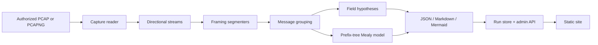

# Architecture

ProtoMind turns an authorized capture into a reviewable protocol hypothesis. The
pipeline is deliberately linear and each stage is a separate module.

## Data flow

## Modules

| Module | Responsibility |
|---|---|
| `protomind.capture.pcap_reader` | Incremental packet parsing, flow grouping, directional TCP/UDP byte streams. |
| `protomind.segmentation.segmenters` | Delimiter, length-prefix and fixed-size candidates plus scoring. |
| `protomind.clustering.types` | Observed message grouping by direction and first token. |
| `protomind.fields.inference` | Constant columns and the first varying region with confidence. |
| `protomind.statemachine.passive` | Prefix-tree Mealy hypothesis from request/reply traces. |
| `protomind.spec.export` | JSON IR, Mermaid state diagram and Markdown spec. |
| `protomind.pipeline` | Orchestrates the stages and writes run artifacts. |
| `protomind.storage.db` | SQLite run and experiment metadata; connections close after each operation. |
| `protomind.api.main` | Upload, run, artifact and guarded experiment endpoints. |
| `protomind.safety.allowlist` | Loopback-only active-target validation and rate limiting. |
| `protomind.safety.redact` | Masks AUTH, LOGIN and PASS arguments without changing lengths. |
| `protomind.evaluation` | Deterministic synthetic captures and the generated report. |
| `targets.tinykv.server` | Toy loopback-only protocol used for demos and active tests. |

## Reassembly

Packets are grouped by a normalized five-tuple. Each direction is sorted by TCP
sequence number and timestamp. Contiguous payloads are joined; duplicate and
overlapping segments are trimmed. A sequence gap inserts a newline sentinel before
the next observed payload so the bytes are not silently fused. UDP datagrams keep
their boundaries.

The sentinel is a documented limitation: it is a marker, not observed traffic.

## Framing

Three candidates are scored:

1. **Delimiter** — CRLF, LF or NUL. A NUL byte only counts when the combined stream
   is at least 85% printable, so binary length prefixes are not mistaken for text.
2. **Length prefix** — offsets 0–8, widths 1/2/4, big and little endian. A candidate
   is accepted only at a score of 0.95 or higher.
3. **Fixed size** — every non-empty stream has the same length.

The highest score wins. A text delimiter wins a tie. If nothing qualifies, the
result is `whole_stream` with score 0.

## Grouping and fields

Messages are labelled `{direction}_{first_token}`. The token is sanitized to ASCII
letters, digits and underscores, with a hex fallback for non-ASCII input. Grouping
is descriptive: `C2S_AUTH` means "client messages whose first token is AUTH", not a
confirmed command schema.

Field inference scans columns up to 64 bytes. A column with one value becomes a
`const` field. The first varying column becomes `string` or `unknown` based on the
printable ratio, with the most common value's share as confidence. Longer payloads
get a `variable_payload` marker.

## State model and exports

Observed client messages are paired with the server message at the same index. The
prefix tree creates a state per observed transition and merges outputs when the same
state/input pair produces different replies. The model contains only observed
behavior.

Each run writes:

- `model.json` — the complete result.
- `machine.mmd` — a Mermaid `stateDiagram-v2`.
- `spec.md` — framing, message types, fields and the state diagram.

## Storage and API

`RunStore` creates two tables: `runs` and `experiments`. Uploads are stored under
`data/captures/{run_id}{suffix}`, artifacts under `data/runs/{run_id}/`, and metadata
in SQLite. The API is a single FastAPI app. There is no authentication layer; it is
intended for loopback use.

## Trust boundaries

- **Capture upload** is untrusted input. The extension and size are checked, but the
  bytes are parsed by scapy. A parser bug is a residual risk.
- **Active experiments** are the only outbound path. The guard accepts literal
  loopback IPs by default, rejects DNS names and non-loopback addresses, and limits
  queries to 30 per minute.
- **Storage** is local. Raw captures are retained; derived examples are redacted for
  AUTH, LOGIN and PASS commands.
- **Deployment** is a loopback Compose service with a read-only root, dropped
  capabilities, no host mounts and resource limits. It is not a public service.
